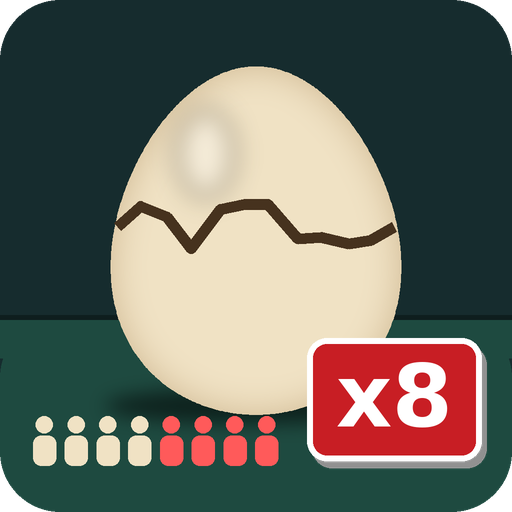

<p align="center">
  
</p>

<h1 align="center">More Players for CRACK</h1>

<p align="center">
  <b>Play <a href="https://store.steampowered.com/app/4312190/CRACK/">CRACK</a> with up to 8 players, with double rooms and bunk beds.</b><br>
  BepInEx 5 mod · by <b>NeZorSpy</b>
</p>

<p align="center">
  <a href="https://github.com/Enzozo02/Crack-Mod4moreplayers/releases/latest"></a>
  
  
</p>

---

## ✨ Features

| | |
|---|---|
| 👥 **Up to 8 players** | The Steam lobby, the Mirror network limit and the in-game player slots all follow one setting, `MaxPlayers` (default and maximum: 8) |
| 🛏️ **Double rooms** | The lab only has 4 crew quarters, so players 5-8 get a **bunk bed** above players 1-4, with posts that match the bed frame |
| 🚪 **Shared room access** | Your roommate's **badge door** and **wardrobe** work for you too, and each player keeps their own outfit |
| 🏷️ **Door plate** | Shows both roommates: `ENZO & PAUL` |
| 🌅 **Proper spawn** | Players 5-8 wake up on their own bunk instead of at the origin of the map |
| 🎨 **Unique colours** | Each player has their own colour (cards and graph on the end-of-shift screen, markers on the egg). Players 5-8: **purple, yellow, pink, teal** |
| 📜 **Lists that fit** | End-of-shift *Team Performance* scrolls by itself (follows each new card, then goes up and down). The *Employee Productivity Ranking* screen shows **pages of 4** (1-4, then 5-8, every 6 s, with a `1/2` indicator) |
| 🧩 **MODS menu** | A new **MODS** button in the main menu lists every installed mod with its image, title, version, author and description (works for any BepInEx mod, see [For modders](#-for-modders-mods-menu-metadata)) |

Room assignment: player 5 → room 1 (upper bunk), 6 → room 2, 7 → room 3, 8 → room 4. Every player has their own bed and colour, so 8 is the maximum.

## ⚠️ Read before installing

- **Every player in the lobby must install the mod**, not just the host. CRACK detects BepInEx, flags the lobby as *modded*, and refuses to mix modded and vanilla players (`Error_ModdedMismatch`).
- **In modded mode the game turns off Steam achievements and leaderboards** (the run is "unranked"). That is the developer's choice, and **this mod does not bypass it**.
- The game is balanced for 4. With 8 players, the egg cracks faster.
- Every CRACK update can break the mod. Check `BepInEx/LogOutput.log` and the [Issues](https://github.com/Enzozo02/Crack-Mod4moreplayers/issues).

## 📥 Installation

1. Download `CRACK_MorePlayers_vX.Y.Z.zip` from the [**Releases**](https://github.com/Enzozo02/Crack-Mod4moreplayers/releases/latest) page.
2. In Steam: right-click **CRACK** → *Manage* → *Browse local files*.
3. Extract **the contents** of the zip next to `CRACK.exe`. The folder should look like this:
   ```
   CRACK/
   ├── CRACK.exe
   ├── winhttp.dll            ← BepInEx loader
   ├── doorstop_config.ini
   └── BepInEx/
       ├── core/              ← BepInEx 5.4.23.3
       ├── config/nezorspy.crack.moreplayers.cfg
       └── plugins/
           ├── CrackMorePlayers.dll
           ├── CrackMorePlayers.png
           └── CrackMorePlayers.json
   ```
4. Launch the game. The main menu should now have a **MODS** button, and `BepInEx/LogOutput.log` should contain:
   ```
   [Info   :MorePlayers] MorePlayers 1.0.0 loaded, MaxPlayers = 8
   [Info   :MorePlayers] Bunk bed created: room 1 -> player 5      (×4, once in the lab)
   ```

> **Steam Deck / Linux:** the zip contains the Windows build of BepInEx, so run the Windows version through Proton (*Properties → Compatibility → Force Proton*) and add `WINEDLLOVERRIDES="winhttp=n,b" %command%` to the launch options. macOS is not supported.

> **Already have BepInEx?** Only copy the files from `BepInEx/plugins/`.

## ⚙️ Configuration

`BepInEx/config/nezorspy.crack.moreplayers.cfg` (created on the first launch):

```ini
[General]
## Maximum players in a lobby (host's value is the one that counts).
# Acceptable value range: From 1 to 8
MaxPlayers = 8
```

The **host's** value decides the lobby size. Clients should use the same value, so the bunk beds show up on their side too.

## 🗑️ Uninstall

- Turn mods off without uninstalling: delete or rename `winhttp.dll`.
- Remove only this mod: delete the 3 `CrackMorePlayers.*` files in `BepInEx/plugins/`.
- Remove everything: delete `winhttp.dll`, `doorstop_config.ini`, `.doorstop_version` and the `BepInEx/` folder.

## ❓ FAQ / Troubleshooting

<details><summary><b>"Error: modded mismatch" when joining</b></summary>
The host or the joining player doesn't have the mod (or BepInEx). Every player needs the same install.
</details>

<details><summary><b>Nothing changes and there's no MODS button</b></summary>
BepInEx isn't loading. Check that <code>winhttp.dll</code> is next to <code>CRACK.exe</code> and that a <code>BepInEx/LogOutput.log</code> file shows up after launching. On Linux/Steam Deck, make sure you run the Windows version through Proton with the launch option above.
</details>

<details><summary><b>The 5th player can't join</b></summary>
Check <code>MaxPlayers</code> in the <b>host's</b> config and that the log says <code>maxConnections 4 -> 8</code>. The host has to create a new lobby after changing the value.
</details>

<details><summary><b>"not found (game updated?)" in the log</b></summary>
CRACK was updated and renamed something the mod patches. Open an issue with your <code>LogOutput.log</code>.
</details>

<details><summary><b>Can I go above 8?</b></summary>
No. 8 is the maximum: the lab has 4 rooms with 2 beds each, and every player gets their own bed and colour. You can set a lower value (for example 6).
</details>

## 🔬 How it works

The full write-up is in [**docs/REVERSE_ENGINEERING.md**](docs/REVERSE_ENGINEERING.md). Short version:

- CRACK is **Unity 6 / Mono** with **Mirror + FizzySteamworks** networking, so BepInEx 5 and Harmony patch it directly.
- **Two locks** on the player count:
  - `NetworkManager.maxConnections` (Steam lobby size and Mirror). The mod raises it before the host starts.
  - A **hard-coded `4`** in `GameManager.GetAvailablePlayerIndex()`. A prefix replaces the search so it goes up to `MaxPlayers`.
- **Per-player objects** (`QuartersRoom`, `Bed`, `QuartersDoor`, `Wardrobe`) are matched on `PlayerController.index` (0-3):
  - `QuartersRoom.Get` folds the index (`i % 4`).
  - A **transpiler** adds `% 4` after each read of `index` in the 6 door and wardrobe checks.
- **Bunk beds:** the beds are **static-batched** (part of a `Combined Mesh` with world-space vertices that can't be read at runtime), so a simple clone is invisible. The bed geometry (1145 vertices) is extracted offline with `tools/extract_bed_mesh.py` and rebuilt at runtime. The posts use a single texel of the bed texture, so they match the frame colour.
- **MODS menu:** the main menu's *Leaderboards* button and panel are cloned, their localization and events are rewired, and the panel is filled from `BepInEx.Bootstrap.Chainloader.PluginInfos`.
- The game's own **mod detection** (`ModDetection`, `modded` lobby flag, `RunRecord.Unrank`, achievements turned off) is **left untouched**.

## 🧩 For modders: MODS menu metadata

Any BepInEx plugin shows up in the **MODS** menu. To give yours an image and a description, put these next to your DLL:

```
BepInEx/plugins/MyMod.dll
BepInEx/plugins/MyMod.png      ← square image (256-512 px)
BepInEx/plugins/MyMod.json
```
```json
{ "title": "My Mod", "author": "You", "description": "What it does.\nSupports line breaks." }
```

The Thunderstore layout works too (a mod in its own folder with `icon.png` and `manifest.json`; the `name`, `author` and `description` keys are read). Without these files, the plugin's name and version from `[BepInPlugin]` are shown.

## 🛠️ Building from source

Requirements: the [.NET SDK](https://dotnet.microsoft.com/download) (6 or later) and CRACK with BepInEx 5 installed.

```bash
git clone https://github.com/Enzozo02/Crack-Mod4moreplayers.git
cd Crack-Mod4moreplayers/src
dotnet build -c Release -p:GameDir="C:\Program Files (x86)\Steam\steamapps\common\CRACK"
# -> bin/Release/CrackMorePlayers.dll  (copy it to BepInEx/plugins/ along with assets/CrackMorePlayers.png & .json)
```

The game's DLLs are referenced from **your** install through `GameDir` and are **never** committed here.

To regenerate the bed mesh after a game update:

```bash
pip install UnityPy numpy
python tools/extract_bed_mesh.py "C:\...\steamapps\common\CRACK" src/BedMeshData.cs
```

## 📁 Repository layout

```
src/        C# sources (MorePlayers.cs = gameplay patches, ModMenu.cs = MODS menu,
            BedMeshData.cs = generated bed mesh, ModsIconData.cs = button icon)
assets/     mod image + metadata JSON shipped next to the DLL, MODS button icon
tools/      extract_bed_mesh.py (regenerates BedMeshData.cs from the game files)
docs/       REVERSE_ENGINEERING.md: full technical analysis
```

## 🤝 Contributing

Issues and PRs are welcome. A useful bug report includes your `BepInEx/LogOutput.log`, the game version (bottom-right of the main menu), the number of players, and who was hosting.

## 📜 Credits & license

- Mod: **NeZorSpy**, released under the [MIT license](LICENSE)
- [BepInEx](https://github.com/BepInEx/BepInEx) (LGPL-2.1) and [HarmonyX](https://github.com/BepInEx/HarmonyX) (MIT), included unmodified in the release zip
- **CRACK** is made by **Rafoli**. This is an unofficial fan mod, not affiliated with or endorsed by the developer. It contains no code or assets from the game. Please support the game on [Steam](https://store.steampowered.com/app/4312190/CRACK/).
